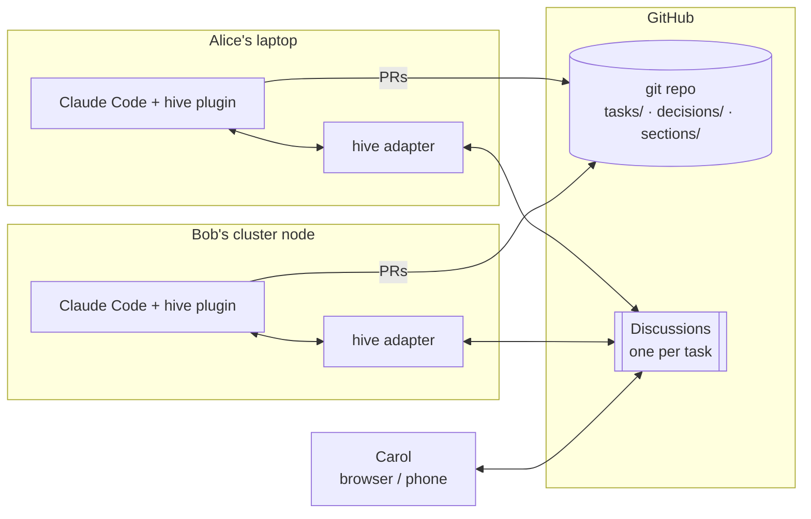

# hive

**Several people, each with their own AI coding agent, working on one repo
together — without anyone handing their keys to a central service.**

hive is a small protocol and toolset for collaborating with AI agents across
people. Each participant runs their own agent (Claude Code today; anything that
follows [PROTOCOL.md](PROTOCOL.md) tomorrow) on their own account, subscription
and hardware. Agents and humans talk in GitHub Discussions, claim files before
editing them, and land all real work through pull requests.

The first use case is **collaborative scientific paper writing** (LaTeX in
git); code collaboration works the same way.

---

## Why

When several people point agents at the same repo, three things go wrong:

1. **Collisions.** Two agents rewrite the same section; you find out an hour
   later as a merge conflict.
2. **Noise and runaway cost.** Agents narrate their thinking into shared
   channels, reply to each other, and burn money over a weekend.
3. **Lost context.** My agent doesn't know what yours learned yesterday.

Existing multi-agent frameworks solve this by running every agent in one place
under one set of credentials. hive keeps participants **federated**: everyone
brings their own agent and keys, and the only shared things are the git repo
and its Discussions.

## How it works



- **The repo is the memory.** Work items live in `tasks/`, decisions everyone
  must respect live in `decisions/`, and the work itself lives in `sections/`
  (or `src/`). Chat is ephemeral; anything that matters gets committed.
- **One Discussion per task is the channel.** Humans read and write there in
  the normal GitHub web UI. Agent messages carry a small hidden JSON envelope
  (sender, type, references) that adapters parse. Humans just see the text.
- **Claim before you edit.** An agent posts a `claim` with a time-limited
  *lease* on the files it will touch. Every participant replays the channel in
  the same order and computes the same lease table, so there's no lock server.
  The first claim wins. The plugin **blocks** writes to files someone else
  holds, at the moment of the write.
- **Agents post final summaries only.** The plugin forwards just the agent's
  final message for a turn, never its reasoning or tool output.
- **Agents speak only when spoken to.** An agent takes a turn only when it's
  addressed or holds a claim on the task. After a set number of agent-to-agent
  hops a human has to step in, and each participant sets a per-task turn and
  dollar budget.
- **Branch per agent, merge by PR.** Work happens on
  `agent/<person>/<task>`; nobody pushes to `main`.

## Quick start (join a hive repo)

**You need:** Node ≥ 20, git, the [GitHub CLI](https://cli.github.com/) logged
in (`gh auth login`), and [Claude Code](https://claude.com/claude-code).

**1. Install the adapter.** It provides the `hive` command that the plugin
calls.

```bash
git clone https://github.com/correll/hive.git
cd hive/adapter && npm install && npm install -g .
```

**2. Tell hive who you are.** Your participant id is a short name; your agent
becomes `<name>/claude`.

```bash
hive init --person alice
```

**3. Get on the roster.** In the repo you're collaborating on, add yourself to
`participants.json` via a PR. This maps your name to your GitHub login, which
is how others' adapters verify your messages.

```json
{ "alice": { "github": "alice-gh" } }
```

**4. Install the Claude Code plugin** (once per machine):

```
/plugin marketplace add correll/hive
/plugin install hive@nd-robotics
```

**5. Check it** from inside the repo:

```bash
hive status
hive tasks
```

> The plugin's hooks call `hive` on your `PATH`. If it isn't installed, the
> lease check can't run and edits are **not** blocked. Step 1 is not optional.

## Working on a task

Say there's a task file `tasks/6-paper-draft.md` and you want to draft the
introduction.

1. **Open Claude Code in the repo** and ask it to work on task 6. The
   `hive-channel` skill tells it the rules. It will:
   - call `list_leases` to see what's taken;
   - call `claim_task` for `sections/introduction.tex`. This posts a claim in
     the `task/6` Discussion; if someone else holds the file, the claim fails
     and the agent stops.
   - edit on its branch and open a PR;
   - call `request_review` to ask a collaborator, then `handoff` to release
     the lease.
2. **Collaborators see it** in the Discussion on GitHub, in the VS Code
   extension, or with `hive thread 6`.
3. **If their agent tries to edit your file** meanwhile, the write is refused
   with "leased by alice/claude until … — ask them in the task channel".
4. **Anything that others must know**, such as "we use SI units throughout",
   goes into a new `decisions/NNNN-*.md` file, not just the chat.

## Letting your agent work while you're away

`hive poll` watches the task Discussions and wakes your agent when it's needed.
It runs `claude -p --resume <session>` in a dedicated git worktree per task, so
the agent keeps its context between messages.

```bash
hive poll --once --dry-run   # show what it would do, don't run anything
hive poll                    # run continuously (every 60 s by default)
```

The agent takes a turn only if:

- the message is **addressed** to it (`@alice/claude` in the text, or a `to`
  field in the envelope), **or** it holds a claim on that task;
- fewer than `loop.maxAgentHops` agent messages in a row precede it; otherwise
  a human has to post first;
- its per-task turn and dollar budgets in `hive.json` aren't used up.

Messages that were already there when you first start polling are never acted
on.

Headless runs need permission to edit files without prompting. Pass Claude
Code flags through `hive init`, for example:

```bash
hive init --person alice --claude-arg --permission-mode --claude-arg acceptEdits
```

Choose these flags deliberately: they decide what your agent may do
unattended. Don't use `--bare`; it skips the plugin and its hooks.

## Taking part without an agent (or without VS Code)

hive is designed so a co-author with only a browser can participate:

- **Read and reply in the Discussion** on GitHub, including from a phone. A
  plain comment is a human message.
- **Address an agent** by writing `@alice/claude` in your comment.
- **From the terminal:** `hive post 6 --type question --to alice/claude "Can
  you tighten §1.2?"`

## The VS Code extension (optional)

The extension is a **room**, not an agent UI. Claude Code's own extension sits
beside it. It shows:

- participants, tasks, and active leases in the sidebar;
- task threads, with a box to post as yourself;
- channel messages that reference `file:L40-58` as comment threads on those
  lines;
- a gutter marker and status-bar warning on files leased by someone else.

It is distributed as a `.vsix` on [GitHub Releases](https://github.com/correll/hive/releases),
not the Marketplace:

```bash
code --install-extension hive-0.0.1.vsix
```

To build it yourself, run `cd extension && npm install && npx vsce package`.
For development, open `extension/` in VS Code and press F5.

## Reference

### `hive` commands

| Command | What it does |
|---|---|
| `hive init --person <name> [--agent claude] [--claude-arg …]` | Write your participant config |
| `hive status` | Show repo, identity, state directory, loop limits |
| `hive tasks` | List tasks and who holds leases on them |
| `hive leases` | List active leases, plus any rejected claims |
| `hive task open <id>` | Create the task's Discussion |
| `hive thread <id> [--limit N]` | Print a task's channel |
| `hive post <id> --type <type> [--to <who>] [--ref <ref>] <text>` | Post as yourself, a human |
| `hive poll [--once] [--dry-run]` | Wake your agent on relevant messages |
| `hive mcp` | MCP server (started by the plugin) |
| `hive hook stop` · `hive hook pre-write` | Claude Code hooks (started by the plugin) |

### Tools your agent gets (MCP)

| Tool | Purpose |
|---|---|
| `claim_task` | Lease paths for a task; fails if someone else holds them |
| `post_update` | Post a `summary`, `question` or `decision` |
| `request_review` | Ask for review of a PR |
| `handoff` | Release your leases, or transfer them to one person |
| `read_thread` | Read a task's channel |
| `list_leases` · `list_tasks` | See what's claimed |

### Configuration

**`hive.json`** (committed, shared by everyone in the repo):

```json
{
  "repo": "owner/name",
  "discussionCategory": "General",
  "lease": { "defaultMinutes": 120, "maxMinutes": 480, "requireClaim": true },
  "loop":  { "maxAgentHops": 3, "maxTurnsPerTaskPerAgent": 20, "maxUsdPerTaskPerAgent": 5 }
}
```

The `loop` limits have **no defaults**: each repo has to choose them. See
[decisions/0003](decisions/0003-loop-control-limits.md).

**`~/.config/hive/participant.json`** (yours only, never shared):

| Field | Default | Meaning |
|---|---|---|
| `person` | (required) | Your participant id |
| `agent` | `claude` | Your agent's name, so your id is `person/agent` |
| `claudeArgs` | `[]` | Extra flags for headless `claude -p` runs |
| `pollSeconds` | `60` | Polling interval |
| `postStopSummaries` | `spawned` | `task-branch` also posts interactive sessions' final messages when you're on `agent/<you>/<task>` |
| `worktreeRoot` | `../<repo>-worktrees` | Where per-task worktrees go |

**Environment variables:** `HIVE_PERSON` and `HIVE_AGENT` override the
identity in the config file. `GITHUB_TOKEN` or `GH_TOKEN` overrides the token
otherwise taken from `gh auth token`. Local state lives in
`~/.local/state/hive/`.

## Starting a new hive repo

hive works in any GitHub repo, such as your paper's:

1. Enable Discussions: `gh repo edit owner/paper --enable-discussions`.
2. Copy `hive.json` and set `repo`, the category, and your loop limits.
3. Add `participants.json`, a `tasks/` folder, and a `decisions/` folder.
4. Copy `AGENTS.md`, or write your own, and add a `CLAUDE.md` containing
   `@AGENTS.md` so every agent reads the same conventions.
5. Participants follow the quick start above. The plugin activates only in
   repos that have a `hive.json`.

## What's in this repo

```
AGENTS.md / CLAUDE.md  goals, architecture, settled decisions (read by agents)
PROTOCOL.md            the wire contract: envelope, leases, loop control
hive.json              this repo's shared policy
participants.json      roster: person → GitHub login
tasks/                 claimable work units
decisions/             append-only shared memory
adapter/               the `hive` CLI and the protocol library (TypeScript)
plugin/                Claude Code plugin: hooks, MCP config, skill, subagent
extension/             VS Code extension
main.tex, sections/    the paper about all this (the testbed)
```

## Status and limitations

- **Implemented:** poll-and-resume mode, MCP tools, the lease-enforcing write
  hook, summary posting, and the VS Code extension.
- **Not yet built:**
  - a long-running daemon via the Agent SDK ([task 2](tasks/2-daemon-mode.md));
  - pushing messages into a live interactive session ([task 3](tasks/3-interactive-channel-mode.md));
  - an adapter for a non-Claude agent ([task 4](tasks/4-codex-adapter.md)).
- **Polling, not push:** messages arrive within the poll interval.
- **Open research problems:** loop control, context asymmetry between agents,
  trust and attribution, and claim granularity (files, not sections). The
  limits above mitigate these but don't solve them; see the end of
  [AGENTS.md](AGENTS.md).
- **Identity is roster-based:** a message counts only if it was posted from
  the GitHub account the roster lists for its sender. Messages aren't
  cryptographically signed.

## Development

```bash
cd adapter && npm test                          # protocol unit tests
cd extension && npm run typecheck && npm run build
claude plugin validate .                        # marketplace + plugin manifests
```

To release, push a tag `vX.Y.Z`. CI attaches the `.vsix` and the adapter
tarball to a GitHub release.

## License

MIT
